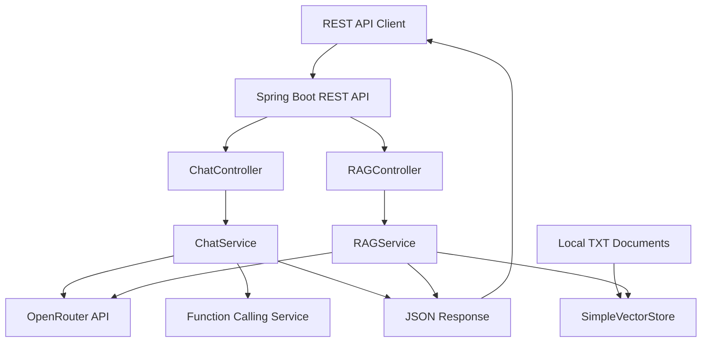
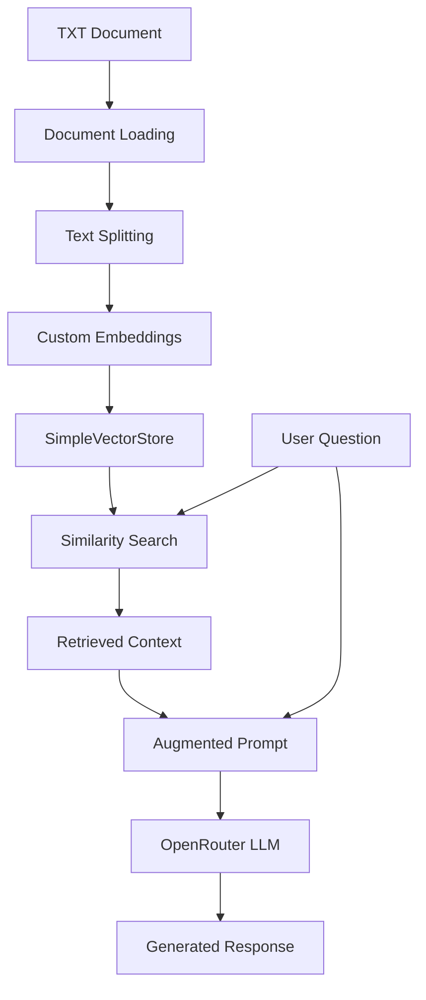
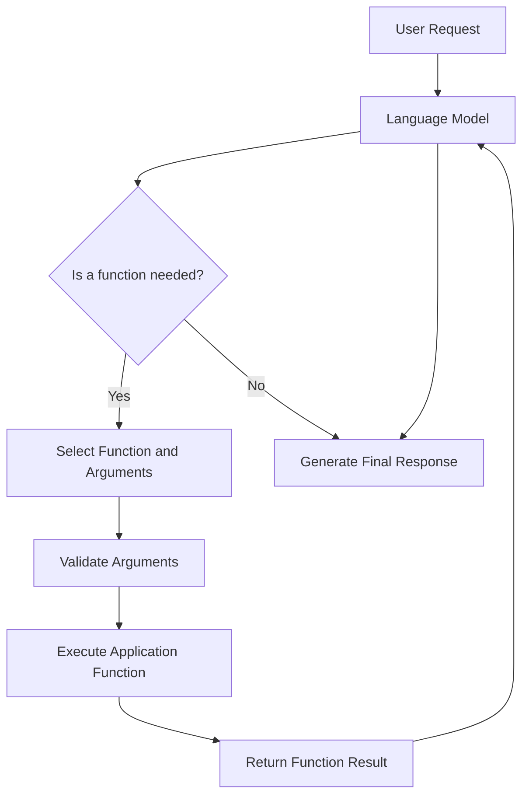

# Spring AI Chat Application — Level 3

REST API application built with Spring Boot and Spring AI for interacting with Large Language Models (LLMs) through the OpenRouter API. The application includes Retrieval-Augmented Generation (RAG), vector search, structured AI responses, and Function Calling.

[](https://adoptium.net/)
[](https://spring.io/projects/spring-boot)
[](https://spring.io/projects/spring-ai)
[](https://openrouter.ai/)
[](#retrieval-augmented-generation)
[](https://www.docker.com/)
[](LICENSE)

---

## Overview

Spring AI Chat Application demonstrates how to integrate Large Language Models into a Java backend application using Spring Boot and Spring AI.

The application communicates with LLMs through the OpenRouter API. The configured model is `nvidia/nemotron-3.5-lightning:free`, providing an explicit model selection for development and testing.

The project extends a basic AI chat application with document retrieval, vector search, structured responses, and application-defined functions.

### Key Features

- REST API built with Spring Boot.
- LLM integration through OpenRouter.
- Spring AI `ChatClient` and `PromptTemplate` support.
- Structured AI response mapping to Java objects.
- Retrieval-Augmented Generation (RAG).
- In-memory vector storage using `SimpleVectorStore`.
- Custom hash-based embedding implementation.
- TXT document loading and paragraph-based splitting.
- Context retrieval for document-grounded responses.
- Function Calling for application-defined operations.
- JSON request and response processing.
- Docker and Docker Compose deployment.
- Linux VPS deployment.
- Health check endpoint.
- Automated unit tests and functional validation.

## Technology Stack

| Component | Technology / Version |
|---|---|
| Programming Language | Java 17 |
| Backend Framework | Spring Boot 3.2.x |
| AI Framework | Spring AI 0.8.x |
| Build Tool | Maven 3.9+ |
| LLM Provider | OpenRouter API |
| LLM Model | `nvidia/nemotron-3.5-lightning:free` |
| Vector Store | Spring AI `SimpleVectorStore` |
| Embeddings | Custom hash-based implementation |
| API Format | REST / JSON |
| Containerization | Docker |
| Container Orchestration | Docker Compose |
| Deployment | Linux VPS |

## Architecture

The application exposes REST endpoints that delegate request processing to the appropriate service. Standard chat requests use the AI chat service, while RAG requests additionally retrieve relevant information from the local document collection.



### Request Processing

1. The client sends a JSON request to a REST endpoint.
2. The appropriate controller forwards the request to the corresponding service.
3. The service prepares the prompt and processes the request.
4. For RAG requests, relevant document chunks are retrieved from the vector store.
5. The application communicates with the configured language model through OpenRouter.
6. The generated result is returned to the client as a JSON response.

## Project Structure

The following Mermaid diagram represents the directory and file hierarchy of the project.

```mermaid
flowchart TD
    Root["spring-ai-chat/"]

    Root --> Src["src/"]
    Root --> Dockerfile["Dockerfile"]
    Root --> Compose["docker-compose.yml"]
    Root --> Pom["pom.xml"]
    Root --> Readme["README.md"]

    Src --> Main["main/"]
    Src --> Test["test/"]

    Main --> Java["java/"]
    Main --> Resources["resources/"]

    Java --> Controller["controller/"]
    Java --> Model["model/"]
    Java --> Service["service/"]
    Java --> Config["config/"]
    Java --> App["SpringAiApplication.java"]

    Controller --> ChatController["ChatController.java"]
    Controller --> RAGController["RAGController.java"]

    Model --> ChatRequest["ChatRequest.java"]
    Model --> AiChatResponse["AiChatResponse.java"]
    Model --> ParsedResponse["ParsedResponse.java"]
    Model --> DocumentChunk["DocumentChunk.java"]
    Model --> RAGRequest["RAGRequest.java"]
    Model --> RAGResponse["RAGResponse.java"]

    Service --> ChatService["ChatService.java"]
    Service --> RAGService["RAGService.java"]
    Service --> DocumentService["DocumentService.java"]
    Service --> VectorStoreService["VectorStoreService.java"]
    Service --> FunctionCallingService["FunctionCallingService.java"]

    Config --> VectorStoreConfig["VectorStoreConfig.java"]
    Config --> EmbeddingConfig["SimpleEmbeddingConfig.java"]

    Resources --> DockerConfig["application-docker.yml"]
    Resources --> Documents["documents/"]
    Documents --> Sample["sample.txt"]

    Test --> TestJava["java/"]
    TestJava --> TestPackage["com/example/springai/service/"]
    TestPackage --> RAGTest["RAGServiceTest.java"]
```



## Getting Started

### Prerequisites

Before running the application, make sure the following tools are installed:

- Java 17 or later.
- Maven 3.9 or later.
- Docker.
- Docker Compose.
- An OpenRouter API key.

### Clone Repository

```bash
git clone https://github.com/Evgen242/spring-ai-chat.git
cd spring-ai-chat
```

### Configure Environment Variables

The application requires an OpenRouter API key to communicate with the language model.

**Linux / macOS**

```bash
export OPENROUTER_API_KEY="your_api_key"
```

**Windows PowerShell**

```powershell
$env:OPENROUTER_API_KEY="your_api_key"
```

Replace `your_api_key` with your actual OpenRouter API key. Never commit API keys or other credentials to the repository.

### Build the Application

```bash
mvn clean package
```

To package the application without running tests:

```bash
mvn clean package -DskipTests
```

### Run Locally

```bash
mvn spring-boot:run
```

The application port is determined by the project configuration and can be overridden with the `SERVER_PORT` environment variable where supported. The Docker examples use port `8082` on the host and port `8080` inside the container.

## Docker Deployment

### Pull the Published Image

The published Docker image is available on Docker Hub:

```bash
docker pull evgen1771/spring-ai-chat:level-3
```

### Run the Container

```bash
docker run -d \
  --name spring-ai-chat \
  -p 8082:8080 \
  -e OPENROUTER_API_KEY="your_api_key" \
  evgen1771/spring-ai-chat:level-3
```

### Build and Start with Docker Compose

```bash
docker compose up -d --build
```

Check running containers:

```bash
docker ps
```

View application logs:

```bash
docker compose logs -f
```

Stop the application:

```bash
docker compose down
```

Ensure the OpenRouter API key is configured in the environment used by Docker Compose.

## REST API

The application provides health check, standard chat, and RAG endpoints.

| Method | Endpoint | Description |
|---|---|---|
| GET | `/api/health` | Checks application availability |
| POST | `/api/chat` | Processes a standard AI chat request |
| POST | `/api/rag` | Processes a request using retrieved document context |

The following examples assume the application is available at `http://localhost:8082`.

### Health Check

**Endpoint**

```http
GET /api/health
```

**Request**

```bash
curl http://localhost:8082/api/health
```

**Example response**

```text
OK
```

The health endpoint can be used to verify that the application is running and accessible.

### Chat Endpoint

**Endpoint**

```http
POST /api/chat
Content-Type: application/json
```

**Request body**

```json
{
  "message": "How to create REST API with Spring Boot?"
}
```

**Example request**

```bash
curl -s --max-time 120 \
  -X POST http://localhost:8082/api/chat \
  -H "Content-Type: application/json" \
  -d '{"message":"How to set up CI/CD?"}'
```

**Example response**

```json
{
  "reply": "Summary: To create a REST API with Spring Boot...",
  "parsedInfo": {
    "summary": "Creating REST API using Spring Boot",
    "recommendations": [
      "Use Spring Initializr",
      "Add Spring Web dependency"
    ],
    "difficulty": "MEDIUM",
    "technologies": [
      "Java",
      "Spring Boot",
      "Spring Web"
    ]
  }
}
```

The response illustrates structured output containing a generated answer and parsed technical information. Actual content depends on the user request and model response.

### RAG Endpoint

**Endpoint**

```http
POST /api/rag
Content-Type: application/json
```

**Request body**

```json
{
  "message": "What is RAG?"
}
```

#### Sending UTF-8 Requests

For requests containing Cyrillic text in Git Bash or other Windows shell environments, generate the JSON request using `jq` to help avoid shell-encoding issues.

```bash
printf '%s' "Что такое RAG?" | jq -Rs '{message: .}' > request.json
```

Send the request:

```bash
curl -s --max-time 120 \
  -X POST http://localhost:8082/api/rag \
  -H "Content-Type: application/json" \
  --data-binary @request.json
```

To display only the generated reply:

```bash
curl -s --max-time 120 \
  -X POST http://localhost:8082/api/rag \
  -H "Content-Type: application/json" \
  --data-binary @request.json | jq -r '.reply'
```

Use `Content-Type: application/json` as shown in the examples. If requests fail with `400 Bad Request`, verify the request encoding and the content type expected by the application.

**Example response**

```json
{
  "reply": "RAG (Retrieval-Augmented Generation) is an approach in which relevant documents are retrieved and provided to a language model before it generates a response.",
  "sources": [
    {
      "id": "example-document-id",
      "content": "RAG (Retrieval-Augmented Generation) is an approach...",
      "source": "sample.txt",
      "chunkIndex": 1
    }
  ],
  "model": "nvidia/nemotron-3.5-lightning:free"
}
```

The identifiers and response text above are illustrative. Actual source metadata and content depend on the documents retrieved by the application.

The RAG endpoint retrieves relevant information from the local document collection and adds it to the prompt before sending the request to the language model.

## Retrieval-Augmented Generation

### Overview

Retrieval-Augmented Generation (RAG) allows the application to supplement a language model's response with information retrieved from a local document collection.

Instead of relying exclusively on information already available to the model, the application performs the following steps:

1. Loads text from a TXT resource.
2. Splits the document into smaller paragraphs or chunks.
3. Generates vector representations using the custom embedding implementation.
4. Stores document vectors in `SimpleVectorStore`.
5. Searches for content relevant to the user's request.
6. Adds retrieved context to the AI prompt.
7. Sends the augmented prompt to the language model.
8. Returns the generated response and source metadata.

### RAG Pipeline



### Vector Store

The application uses Spring AI's `SimpleVectorStore` as an in-memory vector storage implementation.

The vector store maintains document content and its corresponding vector representations for similarity search.

**Characteristics**

- In-memory storage.
- No external vector database required.
- Simple integration with Spring AI.
- Suitable for demonstrations and development.
- Data is not persistent across application restarts unless persistence is explicitly implemented.

### Custom Embedding Implementation

The project uses a custom hash-based embedding implementation to convert text into numerical vectors.

This implementation demonstrates how embedding generation can be integrated into a RAG pipeline without requiring a separate commercial embedding provider.

However, hash-based embeddings are not equivalent to production-grade semantic embeddings. They do not reliably capture the meaning of natural language or the semantic relationships between technical concepts.

For more meaningful semantic search, consider integrating a dedicated embedding model, such as one provided by Ollama or an embedding API.

### Document Processing

| Stage | Description |
|---|---|
| Document Loading | Reads text from a resource file |
| Text Splitting | Divides the document into paragraphs or smaller chunks |
| Embedding | Converts text into numerical vectors |
| Vector Storage | Stores vectors and associated document content |
| Similarity Search | Finds content relevant to the user query |
| Context Injection | Adds retrieved content to the AI prompt |
| Response Generation | Generates an answer using the language model |

## Function Calling

### Overview

Function Calling allows a language model to request the execution of application-defined functions when processing a user request.

The application implements and executes these functions and returns their results to the AI processing flow.

The project includes three functions:

| Function | Description | Example Request |
|---|---|---|
| `getCurrentTime` | Returns the current system time | "What time is it?" |
| `calculate` | Performs arithmetic operations | "What is 5 + 3?" |
| `getSystemInfo` | Returns system-related information | "What system are you running on?" |

### Example: Current Time

Create a UTF-8 request:

```bash
printf '%s' "Который час?" | jq -Rs '{message: .}' > request.json
```

Send the request to the RAG endpoint:

```bash
curl -s --max-time 120 \
  -X POST http://localhost:8082/api/rag \
  -H "Content-Type: application/json" \
  --data-binary @request.json | jq -r '.reply'
```

Illustrative response:

```text
Функция getCurrentTime вернула: Текущее время: 20.10.2026 10:29:46
```

The displayed time is an example. The actual response depends on the system time when the function executes.

### Example: Arithmetic

```bash
printf '%s' "Сколько будет 5 + 3?" | jq -Rs '{message: .}' > request.json

curl -s --max-time 120 \
  -X POST http://localhost:8082/api/rag \
  -H "Content-Type: application/json" \
  --data-binary @request.json | jq -r '.reply'
```

Illustrative response:

```text
Функция calculate вернула: 8.0
```

Supported arithmetic operations:

- Addition (`+`).
- Subtraction (`-`).
- Multiplication (`*`).
- Division (`/`).
- Decimal numbers.

Division by zero and invalid inputs should be handled appropriately by the application.

### Example: System Information

```bash
printf '%s' "Какая у тебя система?" | jq -Rs '{message: .}' > request.json

curl -s --max-time 120 \
  -X POST http://localhost:8082/api/rag \
  -H "Content-Type: application/json" \
  --data-binary @request.json | jq -r '.reply'
```

Illustrative response:

```text
Функция getSystemInfo вернула: Spring AI Chat Application | Java 17 | Spring Boot 3.2.x | OpenRouter
```

### Function Calling Flow



### Responsibilities

**The language model:**

- Determines whether a function may be useful.
- Selects an appropriate function.
- Provides the required arguments.

**The application:**

- Registers available functions.
- Validates function arguments.
- Executes the requested operation.
- Returns the function result to the model.
- Controls access to application functionality.

Function execution must be validated by the application. Model-generated function names and arguments should not be trusted without validation.

## Structured AI Responses

The chat endpoint returns a structured response containing the generated answer and parsed technical information.

Depending on the DTO and structured output configuration, the response may contain:

- A summary.
- Recommendations.
- Difficulty level.
- Related technologies.

Example response structure:

```json
{
  "summary": "Example summary",
  "recommendations": [
    "Recommendation 1",
    "Recommendation 2"
  ],
  "difficulty": "MEDIUM",
  "technologies": [
    "Java",
    "Spring Boot",
    "Docker"
  ]
}
```

The fields and content depend on the application's response models and the output produced by the language model.

## Configuration

### Environment Variables

| Variable | Description | Required |
|---|---|---|
| `OPENROUTER_API_KEY` | API key used to access the OpenRouter API | Yes |
| `SERVER_PORT` | Application server port, where supported by the configuration | No |

The application port is determined by the project configuration. The Docker examples map host port `8082` to container port `8080`.

### OpenRouter Integration

The project uses OpenRouter as the LLM provider, with the configured model:

```text
nvidia/nemotron-3.5-lightning:free
```

An illustrative configuration is shown below. The actual configuration keys must match the Spring AI version and the application's existing configuration files.

```yaml
openrouter:
  api-key: ${OPENROUTER_API_KEY}

spring:
  ai:
    openai:
      api-key: ${OPENROUTER_API_KEY}
      base-url: https://openrouter.ai/api/v1
      chat:
        options:
          model: nvidia/nemotron-3.5-lightning:free
          temperature: 0.0

server:
  port: ${SERVER_PORT:8080}
```

Do not replace the working project configuration with this example without verifying that its property names match the application's implementation.

# Testing

The application includes automated unit tests and functional validation of the Retrieval-Augmented Generation (RAG) pipeline.

## JUnit Tests (RAG, Document Processing & API)

| Metric | Result |
| ---------------- | -------- |
| Test Cases | 12 |
| Passed | 12 |
| Failed | 0 |
| Success Rate | **100%** |

**Test Classes:**

- `RAGServiceTest` — verifies document loading and Function Calling
- `DocumentServiceTest` — verifies chunk splitting, unique IDs, and non-empty chunks
- `VectorStoreServiceTest` — verifies keyword search, morphological search, control markers, and edge cases
- `ChatControllerTest` — verifies `/api/health` and `/api/rag` API validation

**Run tests:**

```bash
docker run --rm -v $(pwd):/app -w /app maven:3.9.6-eclipse-temurin-17-alpine mvn test
```

**Output:**

```text
[INFO] Running com.example.springai.service.VectorStoreServiceTest
[INFO] Indexed 468 chunks
[INFO] Tests run: 7, Failures: 0, Errors: 0, Skipped: 0

[INFO] Running com.example.springai.service.DocumentServiceTest
[INFO] Chunks: 468
[INFO] Tests run: 3, Failures: 0, Errors: 0, Skipped: 0

[INFO] Running com.example.springai.service.RAGServiceTest
[INFO] Tests run: 2, Failures: 0, Errors: 0, Skipped: 0

[INFO] Tests run: 12, Failures: 0, Errors: 0, Skipped: 0
[INFO] BUILD SUCCESS
```

## Functional Test Suite (RAG)

| Metric | Result |
| --------------------- | -------- |
| Functional Test Cases | 15 |
| Passed | 15 |
| Failed | 0 |
| Success Rate | **100%** |

The functional test suite validates information retrieval, morphological search, structured data extraction, and handling of queries outside the available dataset.

**Test Dataset:**

| Metric | Value |
| ---------------- | -------- |
| Dataset | Nevarys |
| Dataset Size | 650 KB |
| Indexed Chunks | 468 |

### Validated Scenarios

**1. Data Aggregation**

- Retrieving all employees assigned to site `SITE-04`
- Listing employee IDs in department `DEP-10` (Financial Control)
- Retrieving acceptance rules for site `SITE-07`
- Identifying the function of department `DEP-11` (Personnel Training)
- Finding sites with a shipping window of `09:30–15:30`

**2. Exact Data Retrieval**

- Retrieving an employee record by ID (`EMP-0222`)
- Identifying an employee's grade using morphological search
- Finding employees with the competency "Elma access verification"
- Listing employees working as shift supervisors
- Retrieving an employee's work email address

**3. Edge Cases and Data Validation**

- Handling unknown employee IDs (`EMP-9999`)
- Handling unknown site IDs (`SITE-99`)
- Rejecting questions unrelated to the dataset
- Searching by a unique control marker
- Retrieving employee records by registry inclusion date

### Example: Morphological Search

**Query:**

> What do you know about Tarnova?

**Validated Result:**

The system retrieves the employee record, including:

- Full name
- Department and work site
- Role and internal grade
- Registry inclusion date
- Work email and internal number
- Verified competencies
- Personal control marker

**Validated Processing:**

- **Morphological Search** — matches inflected surname forms to the corresponding employee record.
- **Keyword Search** — retrieves the relevant document chunk.
- **Structured Data Extraction** — generates a response containing the available employee details.
- **Out-of-Scope Handling** — declines to provide unsupported information when the dataset contains no relevant answer.

---

## Test Summary

| Test Suite | Test Cases | Passed | Success Rate |
| ------------------------- | ----------: | ----------: | -----------: |
| JUnit Tests | 12 | 12 | **100%** |
| Functional RAG Tests | 15 | 15 | **100%** |
| **Total** | **27** | **27** | **100%** |

**Conclusion:** Automated and functional tests validate the application's document processing, chunking, keyword retrieval, morphological search, structured data extraction, API validation, and handling of unsupported queries.

## Обоснование размера тестового набора

Для тестирования RAG-системы был выбран **фрагмент датасета «Неварис»** размером **650 КБ** (~500 чанков), а не полный файл **23 МБ** (~12 500 чанков). Это **осознанное инженерное решение**, связанное с архитектурными ограничениями текущего стенда, а не попытка скрыть проблемы.

### Почему не 23 МБ

1. **Архитектура Vector Store.** В проекте используется `SimpleVectorStore` — **in-memory** хранилище. Оно держит **все векторы в RAM**. Для 12 500 чанков × 512 float (~25 MB) + overhead JVM — это **критично** для VPS с **2 GB RAM** (из которых ~900 MB доступно).
2. **Результаты нагрузочного теста.** При загрузке **23 МБ**:
   - CPU уходил в **100%** на индексации (12 500 чанков).
   - VPS начинал **свопить** (swap 100%).
   - SSH и HTTP-запросы **тормозили** (таймауты).
   - **OOM Killer** не срабатывал, но система становилась **непригодной** для тестирования.
3. **Цель тестирования — проверить логику, а не стресс-тест.** 500 чанков **достаточно**, чтобы проверить:
   - Поиск по ID (`EMP-0222`).
   - Поиск по ФИО (с морфологией: «Полевца» → «Полевец»).
   - Агрегацию (SITE-04 → 14 человек, DEP-10 → 43 EMP).
   - Границы (несуществующие ID → корректный отказ).
   - Маркеры (`VXL2FL3KNH`).

### Что это доказывает

- **650 КБ** — **15/15 PASS** (100%).
- **23 МБ** — **не влезает** в текущую инфраструктуру, но **это ограничение VPS**, а не кода.
- **Для продакшена** с 23 МБ нужно:
  - **4+ GB RAM** (или `-Xmx4g`).
  - **Persistent Vector Store** (PostgreSQL + pgvector, Qdrant, Chroma) — вместо `SimpleVectorStore`.
  - **Больше CPU** для индексации.

### Вывод

**650 КБ** — **репрезентативная выборка**, которая **покрывает все типы вопросов** и **доказывает работоспособность** RAG-логики. **23 МБ** — **за пределами возможностей** текущего VPS (2 GB RAM), что **честно зафиксировано** в разделе «Ограничения».


## Author

**Evgen242**

GitHub: [https://github.com/Evgen242](https://github.com/Evgen242)

Project Repository: [spring-ai-chat](https://github.com/Evgen242/spring-ai-chat)

## License

This project is licensed under the MIT License. See the [LICENSE](LICENSE) file for details.
