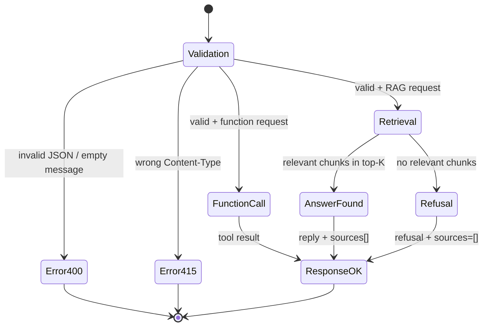

# Test Design — 4 Techniques (Spring AI Chat RAG)

**Related:** `qa/test-plan.md` (strategy), `qa/api-tests.md` (execution), `qa/bug-reports.md` (defects)

This document applies four test-design techniques to the RAG service and maps them to the executed cases A1–A15.

## 1. Equivalence Classes (EC)

Input space divided into classes that should behave equivalently:

| Class ID | Class | Example input | Expected |
|---|---|---|---|
| EC-1 | RAG — aggregation (SITE, DEP) | "Кто работает на SITE-04?" | Full list of employees |
| EC-2 | RAG — exact ID (EMP) | "Кто такой EMP-0222?" | Full employee card |
| EC-3 | RAG — name with morphology | "Какой грейд у Полевца?" | Grade G5 (case handled) |
| EC-4 | RAG — marker (10 chars) | "У кого маркер VXL2FL3KNH?" | Exact employee |
| EC-5 | Function Calling — time | "Который час?" | `getCurrentTime` result |
| EC-6 | Function Calling — arithmetic | "2 + 3?" | `calculate` → 5.0 |
| EC-7 | Out-of-scope (not in doc) | "Как приготовить борщ?" | Refusal, `sources: []` |
| EC-8 | Invalid JSON | `not-a-json` | HTTP 400 |
| EC-9 | Wrong Content-Type | `text/plain` | HTTP 415 |
| EC-10 | Wrong HTTP method | `GET /api/rag` | HTTP 405 |

Mapped to API cases: EC-1 → A3; EC-2 → A2; EC-5 → A4; EC-6 → A5; EC-7 → A6; EC-8 → A10; EC-9 → A12; EC-10 → A13.

## 2. Boundary Values (BV)

For each boundary — test values at, just below, just above, and far beyond:

| Boundary ID | Boundary | Test values | Case |
|---|---|---|---|
| BV-1 | Empty body `{}` (no `message`) | `{}` | A8 |
| BV-2 | Empty message string | `""` | A9 |
| BV-3 | `null` message | `{"message":null}` | A11 |
| BV-4 | Non-existent EMP ID | `EMP-9999` (vs valid `EMP-0222`) | A7 |
| BV-5 | Non-existent site | `SITE-99` (vs valid `SITE-04`) | manual (20/20) |
| BV-6 | Long input — upper bound | 5000 chars | A14 |
| BV-7 | Marker length exactly 10 | `VXL2FL3KNH` | manual (20/20) |
| BV-8 | Arithmetic with zero | `2 * 0` | manual (20/20) |

Note: BV-4 (EMP-9999) is the boundary between "existing ID" (EC-2) and "non-existing ID" (refusal). Same for BV-5.

## 3. Decision Table (DT)

Conditions and actions for request routing:

| # | In document? | Function request? | Valid JSON? | Content-Type OK? | Action | `sources` |
|---|---|---|---|---|---|---|
| DT-1 | Yes | No | Yes | Yes | RAG answer | Non-empty |
| DT-2 | No | No | Yes | Yes | Refusal "нет информации" | `[]` |
| DT-3 | — | Yes | Yes | Yes | Function result | — (no retrieval) |
| DT-4 | — | — | No | Yes | HTTP 400 | — |
| DT-5 | — | — | Yes | No | HTTP 415 | — |
| DT-6 | — | — | Yes | Yes | Wrong method → HTTP 405 (GET) | — |

Mapped to cases: DT-1 → A2, A3; DT-2 → A6, A7; DT-3 → A4, A5; DT-4 → A8–A11; DT-5 → A12; DT-6 → A13.

## 4. State Transition (ST)

Request lifecycle — from input to response:

States mapped to cases:

Validation → FunctionCall → A4, A5

Validation → Retrieval → AnswerFound → A2, A3

Validation → Retrieval → Refusal → A6, A7

Validation → Error400 → A8, A9, A10, A11

Validation → Error415 → A12

Wrong method (GET) → 405 before state machine (Spring dispatcher)

5. Coverage Summary
Technique	Cases designed	Cases executed	PASS	FAIL
EC (10 classes)	8 API + 2 manual	10	10	0
BV (8 boundaries)	4 API + 4 manual	8	8	0
DT (6 rules)	15 API (A1–A15)	15	14	1 (A14 — timeout, BUG-007)
ST (7 transitions)	15 API	15	14	1 (A14)
Total (unique)	15 API + 20 manual	35	34	1
6. Notes
A14 (BV-6, long input 5000 chars) — failed due to free-tier model timeout (>300 s). Documented as BUG-007 (Low/Low, edge case). Not a code defect — a model/provider limit.

Morphology (EC-3) is handled by keyword search with stem (e.g. "Полевца" → "Полевц"). Verified in manual run.

sources behavior is validated by DT-2 and ST (Refusal → sources=[]). This was BUG-003 — now fixed and verified in A6/A7.

All 4 techniques are represented in the executed test set. No gaps in technique coverage.

End of Test Design.
